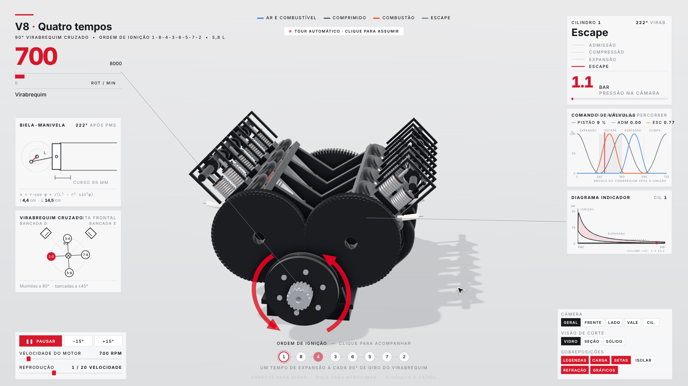

# Motor V8 em 3D

Simulação interativa de um motor V8 quatro tempos, feita para rodar direto no navegador.

## Objetivo
Mostrar de forma visual como um motor V8 funciona: admissão, compressão, expansão e escape.

## Funcionalidades
- Motor em 3D com giro e aproximação
- Câmeras: geral, frente, lado, vale e cilindro
- Visão de corte: vidro, seção e sólido
- Controle de velocidade, pausa e avanço de 15°
- Ordem de ignição 1-8-4-3-6-5-7-2
- Gráficos de comando de válvulas e diagrama indicador

## Tecnologias
HTML, CSS, JavaScript e Three.js (tudo em um único arquivo).

## Minha contribuição
Criei este projeto com o auxílio de inteligência artificial, usando o Claude com skills de Three.js para desenvolver a simulação 3D.

## Evidências

## Como executar
Baixe o arquivo `index.html` e abra no navegador (de preferência no computador).

## Registro
**O que melhorei hoje:** publiquei o projeto no GitHub e documentei no README.

**Próximo ajuste:** corrigir textos sobrepostos nos painéis laterais.
